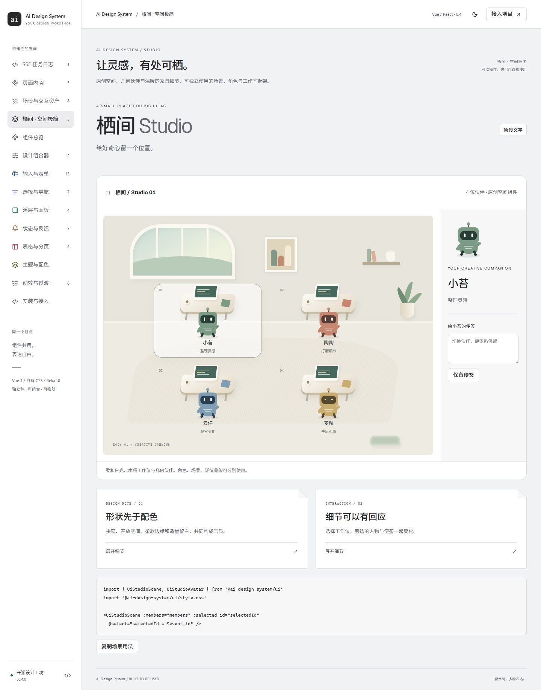
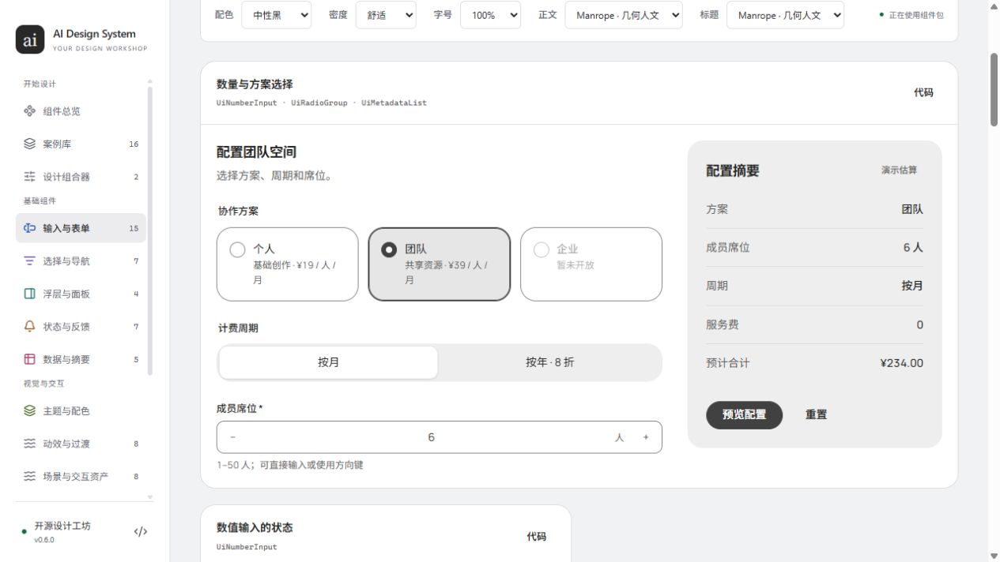
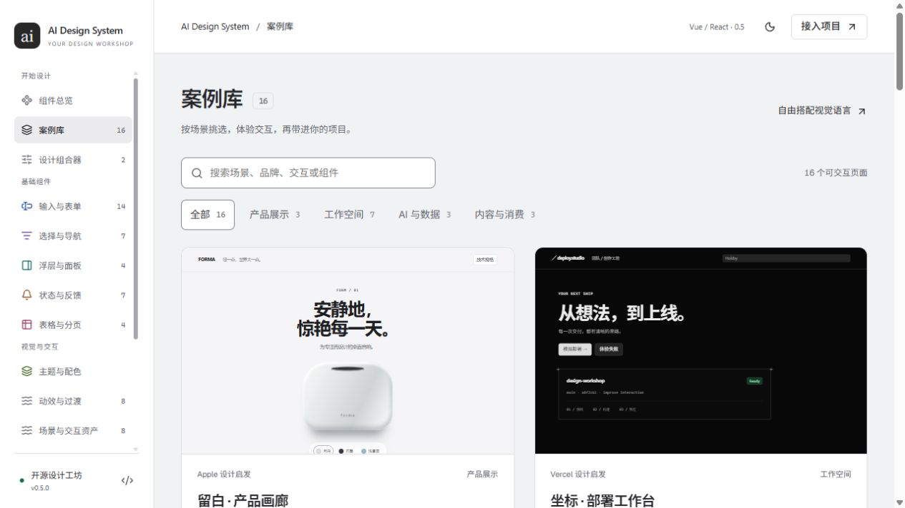
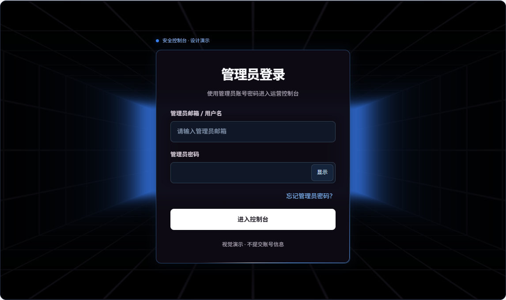
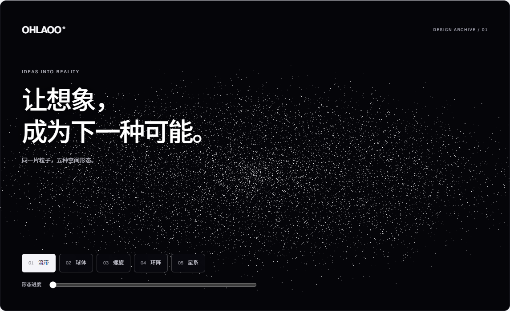
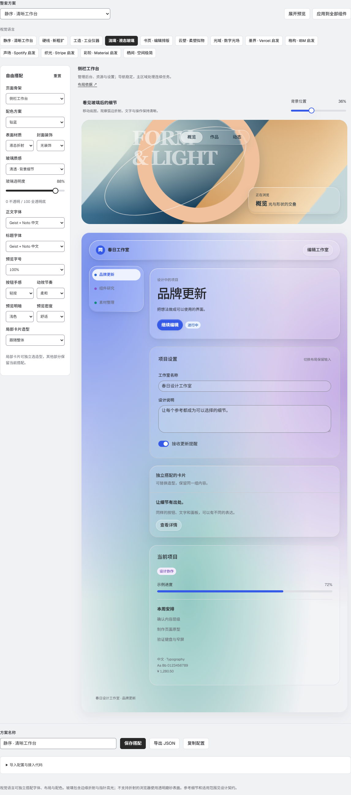
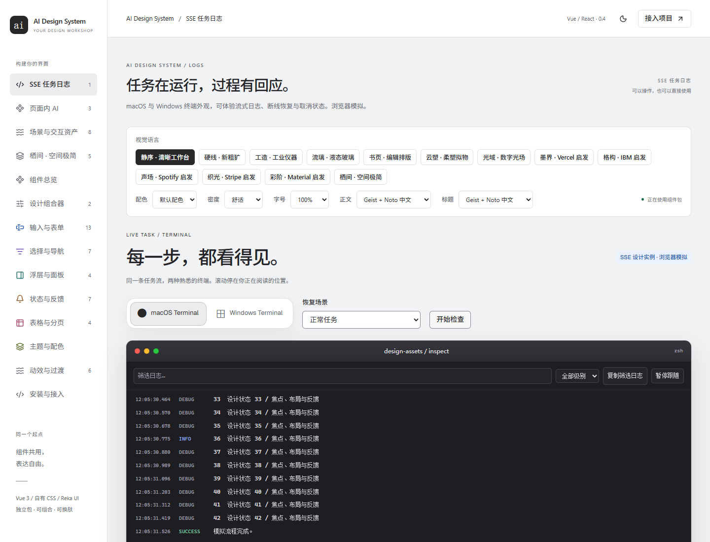

# AI Design System

A personal design workshop made reusable: Vue and React components, complete visual languages, layout patterns, motion, and a portable design skill for AI agents.

[Live demo](https://margetrp-hub.github.io/AI-Design-System/) · [中文](README.md) · [Skill](skills/ai-design-system/SKILL.md) · [API registry](registry/manifest.json)



69 Vue and 18 React components share tokens, CSS and visual effects. Compose 13 visual languages with independent palettes, fonts, materials, transparency and density. Vue includes 14 page layouts and original studio scene components. Explore animation, in-page AI, suggestion review, and macOS / Windows task-log appearances.

The Astryx-inspired direction adds flat inset surfaces, deliberate type and rounded actions. Original Vue controls include a localized number stepper, semantic metadata lists, and card/segmented variants of the existing radio group. [Try the controls](https://margetrp-hub.github.io/AI-Design-System/#forms). No Astryx code, branding or images are bundled; React receives the shared visual language, not the new Vue controls.



The [case library](https://margetrp-hub.github.io/AI-Design-System/#cases) contains 16 original interactive page interpretations inspired by brand design analyses. A real iframe viewport supports presets, custom dimensions, rotation and a grid overlay while preserving page state. Tutorial videos feed component details and skill guidance, rather than automatically becoming page cases.

Search by task, interaction or component, open a direct case link, and return with filters and reading position intact. Preview and integration views retain drafts; copy Vue usage or an AI design brief from each detail. Mobile uses grouped drawer navigation. The [installation guide](https://margetrp-hub.github.io/AI-Design-System/#install) separates Vue and React APIs and supported capabilities. Button demos include Chinese, English and German labels in a narrow container.



The [asset workshop](https://margetrp-hub.github.io/AI-Design-System/#assets) separates a centered administrator login with a four-plane scanning tunnel, the original OHLAOO five-shape particle field, and the split character login. Layouts, effects and console-form recipe styles ship for both Vue and React.




```sh
git clone https://github.com/margetrp-hub/AI-Design-System.git
cd AI-Design-System
npm ci
npm run build:registry
npm run dev
```

Requires Node.js 22.12+. Visit `http://127.0.0.1:4318`. Built with Vite, TypeScript, Vue and scoped CSS. No Tailwind requirement. Vue uses Reka UI primitives; React has its own typed interfaces and shares the visual foundations.

Build tarballs with `npm run pack:ui` or `npm run pack:react`. Install the generated tokens, styles, effects, stream and framework tarballs together. Packages are not yet on the npm registry. [Integration](docs/integration.md) · [Releases](https://github.com/margetrp-hub/AI-Design-System/releases).



Copy `skills/ai-design-system` into your agent's skill directory and invoke `$ai-design-system`. It separates layout, visual language, palette, typography and motion, then queries real APIs:

```sh
npm run ui -- doctor
npm run ui -- find --framework vue scene
npm run ui -- show --framework react UiTaskLog
```



All online AI and SSE interactions are labeled **browser simulations**. No model calls, task backend, shell commands or business data. The standalone stream package can connect to a real service in your application.

Next.js and Electron require host testing. React Native and Uni-app currently receive token mappings only. [Platform boundaries](docs/platforms.md).

MIT for original code. Third-party notices remain applicable. Studio robots, furniture and scene geometry are original; no workstation-teacher drawings or code are distributed. Reference-inspired design languages are not affiliated with their reference brands. [Provenance](docs/design-absorption.md).
