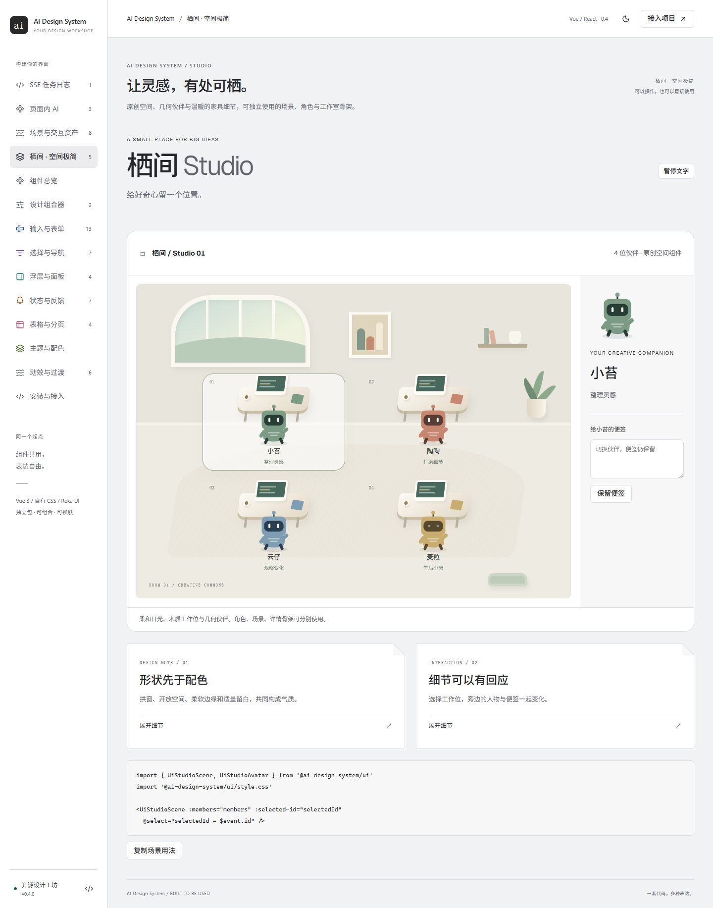
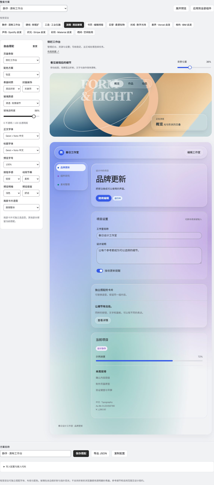
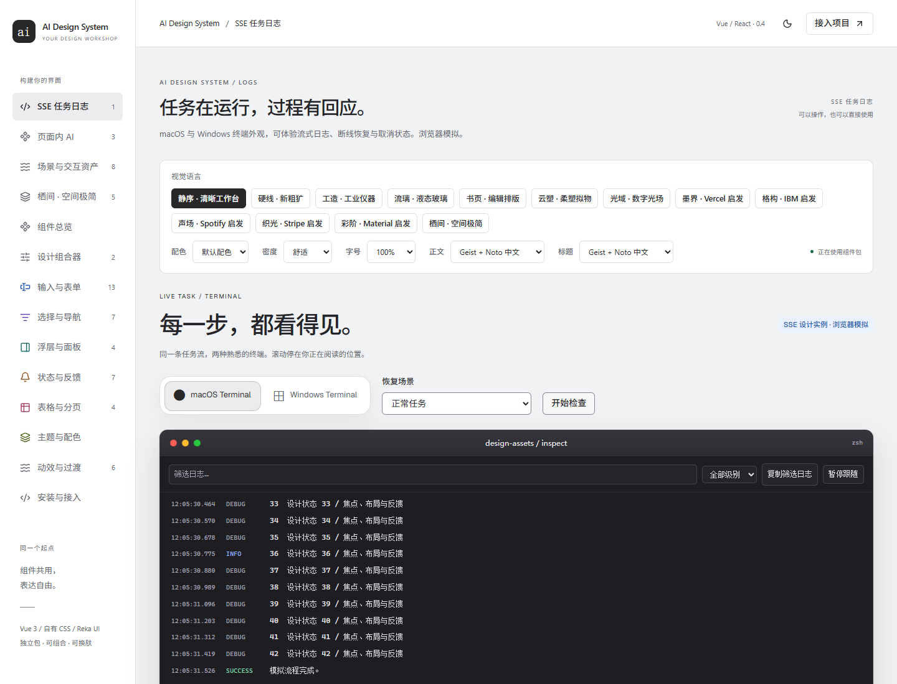

# AI Design System

**把好的设计做成资产，让人和 AI 都能直接使用。**

一个持续生长的个人设计工坊：可安装的 Vue / React 组件、完整视觉语言、页面骨架、动效与 AI 设计技能。自由搭配外观，也保留每种设计自己的性格。

[在线体验](https://margetrp-hub.github.io/AI-Design-System/) · [English](README.en.md) · [设计 Skill](skills/ai-design-system/SKILL.md) · [接入指南](docs/integration.md) · [设计契约](DESIGN.md)



## 已经可以用什么

| 资产 | 内容 |
| --- | --- |
| 基础组件 | 62 个 Vue、18 个 React 组件；表单、导航、弹层、数据、反馈、AI 与终端日志 |
| 完整视觉语言 | 静序、硬线、工造、流璃、书页、云塑、光域、墨界、格构、声场、织光、彩阶 |
| 自由组合 | 配色、字体、布局、材质、透明度、字号、密度、装饰与动效分别可选；导出组合 JSON |
| 页面骨架 | 14 种 Vue 布局：后台、主从、工作台、阅读、分屏、设置、会话、看板、创作空间等 |
| 交互资产 | 光束、星尘、角色、轨道、流光边框、文字与数字动效、折页札记、原创栖间场景 |
| 页面内 AI | 输入上下文、建议应用/撤销、工具状态、流式内容、Mac / Windows 任务日志 |
| AI 使用入口 | 源码生成的接口清单、框架筛选 CLI、任务组合、可移植 Skill |



视觉语言改变导航、几何、文字层级、材质和交互。配色是独立选择，不把换一个主色当作新风格。流璃提供可调透明度、清透/柔透材质与 Web 边缘折射；具体浏览器能力见 [平台边界](docs/platforms.md)。

## 运行工坊

需要 Node.js 22.12+ 与 npm。

```sh
git clone https://github.com/margetrp-hub/AI-Design-System.git
cd AI-Design-System
npm ci
npm run build:registry
npm run dev
```

打开 `http://127.0.0.1:4318`。技术栈为 Vite、TypeScript、Vue、独立 CSS；Vue 使用 Reka UI 管理弹层/焦点行为，React 共用同一套 CSS、tokens 和动效运行时。消费方不必安装 Tailwind。

## 在自己的项目中使用

运行 `npm run pack:ui` 或 `npm run pack:react`，在消费方一次安装生成的 tokens、styles、effects、stream 和框架包五个 tgz。详见 [接入指南](docs/integration.md)。

```vue
<script setup lang="ts">
import { UiTheme, UiButton } from '@ai-design-system/ui'
import '@ai-design-system/ui/style.css'
</script>
<template>
  <UiTheme design="industrial" palette="jade" mode="light">
    <UiButton variant="primary">开始创作</UiButton>
  </UiTheme>
</template>
```

React 使用 `@ai-design-system/react`。包可自行构建或从 [Releases](https://github.com/margetrp-hub/AI-Design-System/releases) 下载；目前未发布到 npm registry。类型和 API 以 [组件清单](registry/manifest.json) 为准，同名 Vue / React 组件不保证接口相同。

## 让 AI 直接使用

将 [skills/ai-design-system](skills/ai-design-system) 目录复制到工具支持的 skills 目录，调用 `$ai-design-system`。它先识别框架、任务与参考，再查询真正存在的组件。

```sh
npm run ui -- doctor
npm run ui -- find --framework vue 角色
npm run ui -- show --framework react UiTaskLog
```

> 用 AI Design System 做一个工业仪器感的任务页。保留钴蓝配色，使用侧导航和 Mac 风格日志；明确加载、失败和重试状态。

Skill 将视觉语言、配色、字体和页面骨架分别选择，并使用真实组件接口。[AI 接入](docs/ai.md) · [任务组合](registry/tasks.json) · [规划与吸收方式](docs/architecture.md)



在线 AI / SSE 页面全部是**浏览器模拟设计实例**，不连接模型、不执行 Shell 或业务任务。真正接入 SSE 时可使用独立 stream 包；暂停阅读跟随、停止接收与取消业务任务各有不同含义。

## 支持与维护

Vue 和 React 有构建、包安装与浏览器验收。Next.js / Electron 需在消费项目验证；Uni-app 和 React Native 目前仅提供 token 映射，不提供原生组件。[平台边界](docs/platforms.md)

```sh
npm run check
npm run test:browser
npm run check:packages
```

[实现验证](docs/verification.md) · [贡献方式](CONTRIBUTING.md) · [来源与许可](docs/design-absorption.md)

自有实现使用 [MIT](LICENSE)，第三方依赖与改编保留各自许可。栖间的机器人、家具与空间为原创；未包含 workstation-teacher 的角色、家具或源码。品牌启发的视觉语言不代表官方关联。
